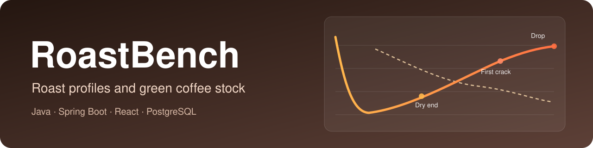
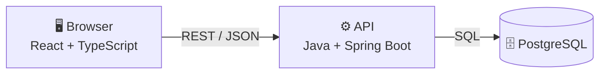

<div align="center">



<br>

### Keep your roasts and your green coffee stock in one place

<br>

[](https://github.com/vladimirmilivojevic-creator/roastbench/actions/workflows/ci.yml)
[](LICENSE)


**[Live demo](https://vladimirmilivojevic-creator.github.io/roastbench/)** &nbsp;·&nbsp;
**[Screenshots](#screenshots)** &nbsp;·&nbsp;
**[How it works](#how-it-works)** &nbsp;·&nbsp;
**[Quick start](#quick-start)**

</div>

> **Note:** the live demo runs on a free server. If nobody used it for a while, the first page can take up to
> 1 minute to open. After that it is fast.

---

## What is RoastBench?

RoastBench is a web app for small coffee roasteries. A roaster has two daily questions:

1. **"Did this roast turn out like my best roast?"**
2. **"How much green coffee do I have left?"**

RoastBench answers both. You load a roast file, the app draws the roast and calculates the important numbers, and it
compares the roast with your best one. At the same time it counts your green coffee: every roast takes its coffee out of
stock, and you get a warning before a lot runs out.

## Screenshots

<table>
  <tr>
    <td width="50%"><b>Dashboard</b><br></td>
    <td width="50%"><b>Green coffee stock</b><br></td>
  </tr>
  <tr>
    <td width="50%"><b>Compare roasts</b><br></td>
    <td width="50%"><b>Import a roast file</b><br></td>
  </tr>
</table>

<details>
<summary><b>One roast, compared with the reference roast (click to open)</b></summary>
<br>

</details>

## Features

| | |
|---|---|
| 📥 **Import roast files** | CSV and [Artisan](https://github.com/artisan-roaster-scope/artisan) `.alog` files. You see a preview before anything is saved. |
| 📈 **Roast chart** | Bean temperature, environment temperature and rate of rise. Zoom in, switch lines on and off. |
| 🔢 **The key numbers** | RoR, DTR (development time ratio) and roast loss. The roast is split into drying, Maillard and development. |
| ⭐ **Reference roast** | Mark your best roast. Every other roast of that profile is compared with it. You can also put up to 10 roasts on one chart. |
| 🫘 **Green coffee stock** | Lots with country, farm and process. Deliveries, corrections and moves between places. |
| 🔔 **Low-stock warnings** | Set a minimum per lot. The app also tells you how many days the coffee will last. |
| 🧾 **API documentation** | Every endpoint is documented with OpenAPI (Swagger UI). |
| 🌗 **Light and dark theme** | Works on desktop and phone. |

## How it works



**What happens when you import a roast file**

1. You drop a CSV or `.alog` file. The API **reads** it and finds the temperatures and events (charge, first crack, drop).
2. The API **calculates** RoR, DTR, roast loss and the phases, and sends everything back as a **preview**.
3. You check the chart, choose the coffee lots you used, and press *Import*.
4. In **one database transaction** the API saves the roast, takes the coffee out of stock and writes a line in the stock
   list. If there is not enough coffee, nothing is saved.
5. The roast is now in the list, and you can compare it with the reference roast.

## The roast numbers

| Name | Meaning | How it is calculated |
|---|---|---|
| **RoR** (rate of rise) | How fast the bean temperature goes up, in °C per minute | The slope of the temperature line over a short time window (30 seconds) |
| **Turning point** | The coldest moment after the beans go in | The lowest bean temperature in the first minutes |
| **DTR** (development time ratio) | How much of the roast is "development" | time from first crack to drop ÷ total time × 100 |
| **Roast loss** | How much weight the beans lose | (green weight − roasted weight) ÷ green weight × 100 |

More details are in [docs/import-formats.md](docs/import-formats.md).

## Quick start

**With Docker** (one command):

```bash
docker compose up
```

Open **http://localhost:8080**. The first start builds the images and fills the database with example data.
The API documentation is at http://localhost:8080/swagger-ui.html.

**Without Docker** (you need Java 21 and Node 22; no database to install):

```bash
# Terminal 1: the API on port 8080 (it starts its own PostgreSQL)
cd backend
./mvnw spring-boot:test-run

# Terminal 2: the website on port 5173
cd frontend
npm install
npm run dev
```

Open **http://localhost:5173**.

## Tests

```bash
cd backend  && ./mvnw verify    # unit tests + integration tests with a real PostgreSQL
cd frontend && npm test         # frontend tests
```

| Level | Tool | What is tested |
|---|---|---|
| Unit tests | JUnit 5 | The roast calculations, the file readers, the stock rules |
| Integration tests | JUnit 5, Rest Assured, Testcontainers | Every endpoint with a real PostgreSQL. For example: importing a roast takes coffee out of stock, and two roasts at the same time cannot use the same coffee twice |
| Frontend tests | Vitest | Number formatting, the chart settings, the pages |
| Browser tests | Playwright | The whole app in a real browser, started with `docker compose up` |

**GitHub Actions** runs all of this on every push (see the badge at the top).

## Project structure

```
roastbench/
├── backend/     Java API (Spring Boot)
│   └── src/main/java/dev/roastbench/
│       ├── analysis/    the roast calculations (RoR, DTR, loss, comparison)
│       ├── imports/     reads CSV and Artisan .alog files
│       ├── roast/       roasts: save, list, compare
│       ├── profile/     profiles and the reference roast
│       ├── inventory/   lots and the stock list
│       └── demo/        example data
├── frontend/    React website
│   └── src/
│       ├── pages/       one file per page
│       ├── components/  buttons, chart, dialogs
│       ├── api/         talks to the API
│       └── domain/      formatting and chart settings
├── e2e/         browser tests (Playwright)
├── samples/     example roast files (CSV and .alog)
└── docs/        extra documentation and screenshots
```

## About the data

All roasts and coffee lots in this project are **made up**. The roast curves are generated by a small program so they
look like real roasts. They were not recorded on a real roaster.

## License

This project is **not open source**. You may read the code and run it on your own computer to look at the project. You
may not copy it, use it in another project, or run it for other people. See [LICENSE](LICENSE).

## Author

**Vladimir Milivojevic**, software developer, Innsbruck, Austria
· [github.com/vladimirmilivojevic-creator](https://github.com/vladimirmilivojevic-creator)
