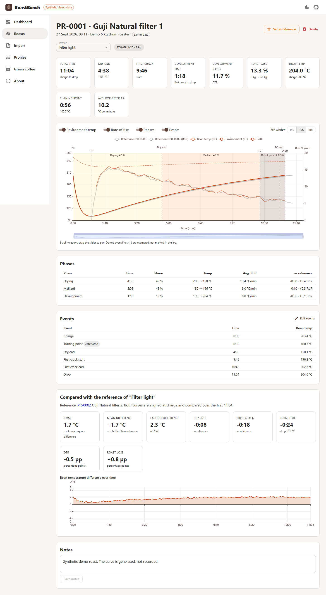
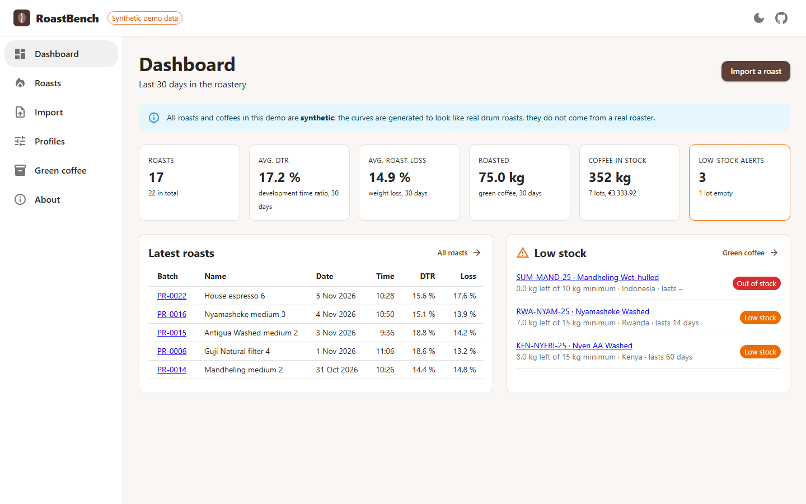
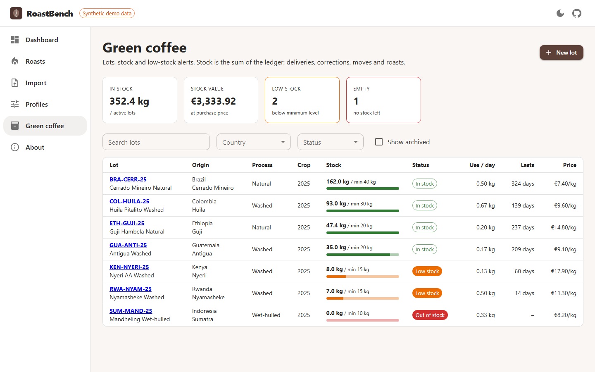
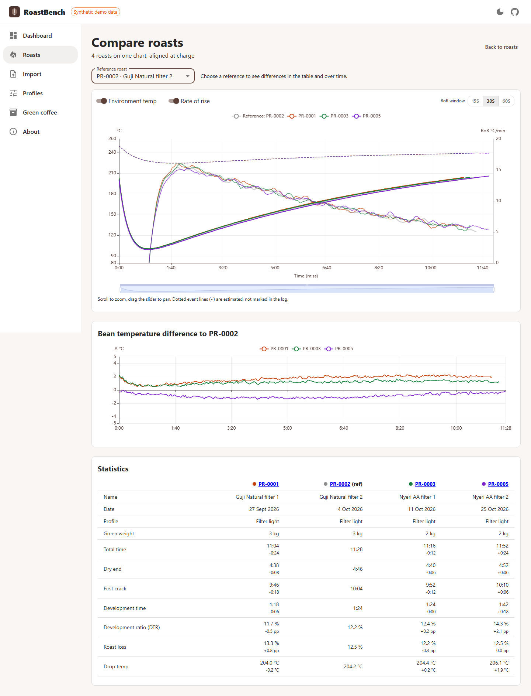
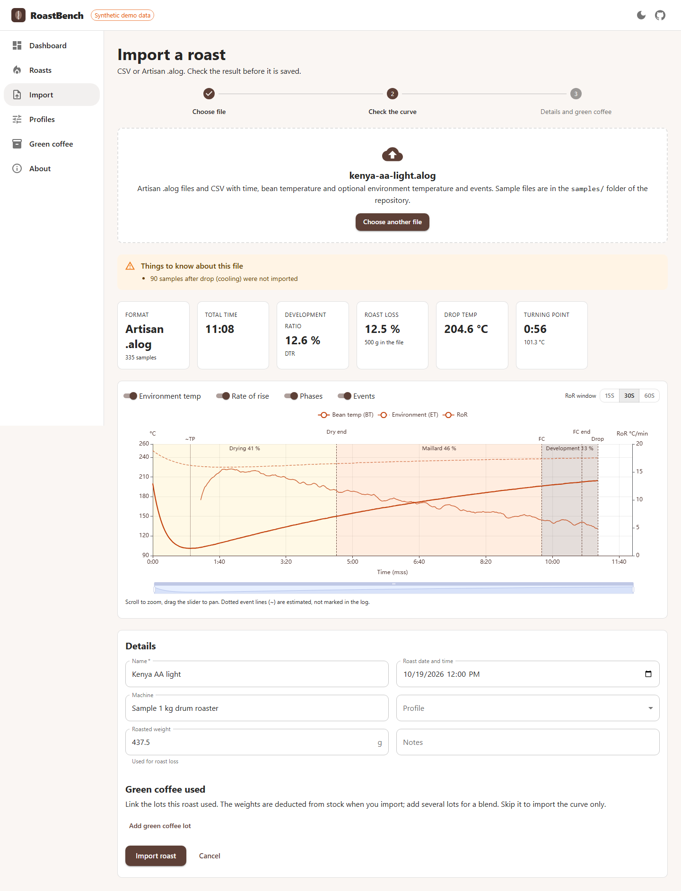

# RoastBench

[](https://github.com/vladimirmilivojevic-creator/roastbench/actions/workflows/ci.yml)
[](LICENSE)


**Roast profile and green coffee inventory app for small roasteries.** Import a roast log, see its rate of rise,
development time ratio and roast loss, compare it with the reference profile in an interactive chart, and keep track of
the green coffee that goes into every batch.



> **The data in this repository and in the demo is synthetic.** The roast curves are generated to look like drum roasts
> (a turning point, a decaying rate of rise, first crack, development); they do not come from a real roaster.

## What it does

- **Imports roast logs** from CSV and from [Artisan](https://github.com/artisan-roaster-scope/artisan) `.alog` files,
  with a preview that shows the curve, the metrics and any assumptions *before* anything is saved.
  ([formats](docs/import-formats.md))
- **Calculates** the rate of rise (RoR), the development time ratio (DTR) and the roast loss, and splits every roast into
  drying, Maillard and development phases.
- **Compares** a batch with the reference roast of its profile (differences in temperature over time, dry end, first
  crack, drop, DTR, loss) or lays up to ten batches over each other.
- **Tracks green coffee**: lots with origin details, an append-only stock ledger (deliveries, corrections, transfers,
  roasts), automatic deduction when a roast is imported, **low-stock alerts** and a days-of-stock projection.
- **REST API documented with OpenAPI**: Swagger UI at `/swagger-ui.html`, the contract in
  [`docs/openapi.json`](docs/openapi.json) (checked by a test, so it cannot drift).

| | |
|---|---|
|  |  |
|  |  |

## Run it

### With Docker (one command)

```bash
docker compose up
```

Open <http://localhost:8080>. The first start builds the images and fills the database with synthetic demo data;
Swagger UI is at <http://localhost:8080/swagger-ui.html>. `docker compose down -v` removes everything.

### Without Docker (development)

Needs JDK 21 or newer and Node 22. No database to install: the backend starts real PostgreSQL binaries in-process.

```bash
# terminal 1 - API on :8080 with embedded PostgreSQL and demo data (kept in backend/.dev-data)
cd backend
./mvnw spring-boot:test-run

# terminal 2 - web app on :5173
cd frontend
npm install
npm run dev
```

Open <http://localhost:5173>. To start over with fresh demo data:
`curl -X POST -H "X-Admin-Token: dev" localhost:8080/api/admin/demo/reset`.

## Tests

```bash
cd backend  && ./mvnw verify          # unit + integration tests (embedded PostgreSQL, no Docker needed)
cd frontend && npm test               # Vitest: domain logic, API client, components
cd e2e && npm ci && npx playwright install chromium && npm test   # against a running app, see e2e/playwright.config.ts
```

CI ([`.github/workflows/ci.yml`](.github/workflows/ci.yml)) runs three jobs: the backend against PostgreSQL started by
**Testcontainers**, the frontend (lint, type check, tests, build), and **end-to-end tests with Playwright against
`docker compose up`**, which is also the proof that the one-command start works.

| Level | What is tested |
|---|---|
| Unit (JUnit 5) | roast mathematics with hand-computed cases, CSV and `.alog` parsers incl. malformed and hostile input, stock allocation |
| Integration (JUnit 5, Rest Assured, PostgreSQL) | migrations, every endpoint, import → stock deduction → alert, rollback on insufficient stock, concurrent roasts on one lot, OpenAPI snapshot |
| Frontend (Vitest, Testing Library) | formatting, chart option builder, API errors, wake-up gate, dashboard, import wizard |
| End to end (Playwright) | import with stock deduction, painted charts, comparison, event editing, inventory alerts |

## How it is built

```
backend/    Spring Boot 3 (Java 21): analysis/ imports/ roast/ profile/ inventory/ demo/ common/, Flyway migrations
frontend/   React + TypeScript + MUI + Apache ECharts; src/domain holds framework-free logic
e2e/        Playwright tests (and the script that takes the screenshots above)
samples/    synthetic roast logs in both import formats
docs/       architecture, import formats, OpenAPI contract
```

The interesting parts are deliberately framework-free so they are easy to read and test:

- [`analysis`](backend/src/main/java/dev/roastbench/analysis): rate of rise as a windowed regression slope, phases, DTR,
  roast loss, turning point, reference comparison.
- [`imports`](backend/src/main/java/dev/roastbench/imports): the CSV reader and an Artisan reader built on a small
  Python-literal parser that never evaluates anything.
- [`frontend/src/domain`](frontend/src/domain): number formatting and the ECharts option builder.

Stock is a **ledger**: a lot's stock is the sum of append-only movements, every posting locks the lot row, and a roast
and its deduction are one transaction. [`docs/ARCHITECTURE.md`](docs/ARCHITECTURE.md) explains this and the other
decisions, with diagrams.

## Stack

Java 21 · Spring Boot 3 · Spring Data JPA · Flyway · PostgreSQL · springdoc OpenAPI · JUnit 5 · Rest Assured ·
Testcontainers · React · TypeScript · MUI · TanStack Query · Apache ECharts · Vitest · Playwright · Docker ·
GitHub Actions

## License

[MIT](LICENSE) · Vladimir Milivojevic
