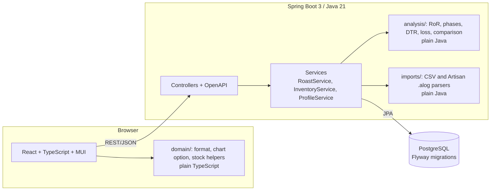
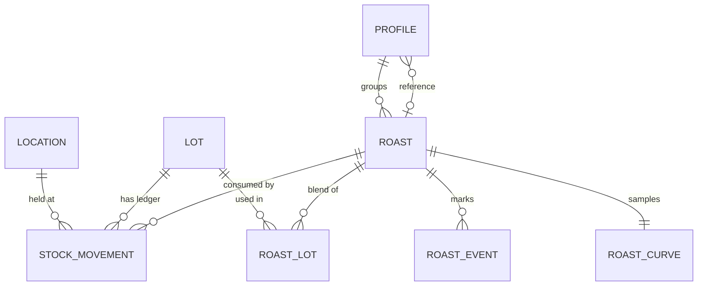

# Architecture

RoastBench is a conventional three-tier web app with one unusual rule: **the roast mathematics and the chart logic are
plain code with no framework in it**, so they can be tested in milliseconds and read without knowing Spring or React.

## Backend packages

| Package | Responsibility |
|---|---|
| `analysis` | Immutable `RoastCurve`, `RorCalculator`, `CurveAnalyzer` (phases, DTR, loss, turning point), `ReferenceComparator`. No Spring, no I/O. |
| `imports` | `CsvRoastParser`, `ArtisanAlogParser` on top of `PythonLiteralParser`, and `RoastLogImporter` that picks the parser and trims the cooling phase. No Spring except one `@Component`. |
| `roast`, `profile`, `inventory` | One feature each: entities, repositories, service, controller and DTOs. |
| `demo` | The deterministic synthetic roast generator, the demo seed and the token-protected reset. |
| `common` | Problem-detail error mapping, CORS and OpenAPI configuration, settings. |

## Data model

The schema is in [`V1__initial_schema.sql`](../backend/src/main/resources/db/migration/V1__initial_schema.sql).

## Decisions worth knowing about

**Stock is a ledger, not a number.** `stock_movement` is append-only; a lot's stock is the sum of its rows. Nothing is
edited or deleted, so every kilogram is explainable (`RECEIPT`, `ROAST_CONSUMPTION`, `ADJUSTMENT`, `TRANSFER_IN/OUT`,
`ROAST_REVERSAL`). A database check keeps the sign of each quantity consistent with its type. Deleting a roast books a
reversal instead of rewriting history. The ledger is shown in booking order, because the running balance only makes sense
in that order; each row also carries the date the event happened (a roast imported today can be from last week).

**Concurrent roasts cannot overspend a lot.** Every posting takes a pessimistic row lock on the lot first, then checks
the stock. `RoastApiIT.concurrentRoastsCannotSpendTheSameKilogramsTwice` starts four simultaneous 5 kg imports against
6 kg of stock and expects exactly one to succeed.

**A roast and its stock deduction are one transaction.** If a lot runs short, the whole import rolls back: no roast, no
curve, no movements.

**Roast curves are stored as `double precision[]`** next to the roast (time, bean and environment temperature), and the
summary figures (total time, DTR, loss, drop temperature, …) are stored as columns so the list can sort and filter in
SQL. The detailed metrics are recomputed from the curve and the marked events on every read, so editing an event
(`PATCH /api/roasts/{id}`) can never leave stale numbers behind.

**The Artisan reader never evaluates code.** `.alog` is a Python literal. A tiny recursive-descent parser builds plain
Java values and caps the nesting depth; tests cover injection attempts and a 5 000-level nesting bomb.

**The API contract is checked in.** `docs/openapi.json` is generated from the running app and `OpenApiSnapshotIT` fails
when the code and the file disagree, so the documented API cannot drift.

**No Docker on a small laptop.** Integration tests share one base class that starts either real PostgreSQL binaries
in-process (embedded, default, no Docker) or a Testcontainers `postgres:16`. CI uses Testcontainers and runs the full
stack with `docker compose` plus Playwright; a developer without Docker runs the very same tests locally with
`./mvnw verify`.

## Frontend

`src/domain` is plain TypeScript: number and duration formatting, the ECharts option builder (axes, event lines, phase
areas, RoR from the turning point, tooltips), stock helpers. React components only render. Server state is TanStack
Query; every mutation refreshes the cache, because one action (importing a roast) changes lists, stock and metrics at
once. The API is reached through one `fetch` wrapper that turns RFC 9457 problem responses into typed errors with
field-level messages.

The static site is separate from the API on purpose: on free hosting the API sleeps when idle, so the page loads
immediately and an explanatory screen (`ApiGate`) waits for the API to wake up instead of showing broken pages.

## Testing pyramid

| Level | Tooling | What it covers |
|---|---|---|
| Unit | JUnit 5 | analysis maths with hand-computed cases, parsers (valid, malformed, hostile input), stock allocation |
| Integration | JUnit 5, Rest Assured, Testcontainers / embedded PostgreSQL | migrations, every endpoint, import → stock → alert flows, concurrency, OpenAPI snapshot |
| Frontend unit and component | Vitest, Testing Library | formatting, chart option builder, API client errors, API wake-up gate, dashboard, import wizard |
| End to end | Playwright against `docker compose up` | import with stock deduction, charts painted, comparison, inventory alerts, event editing |
